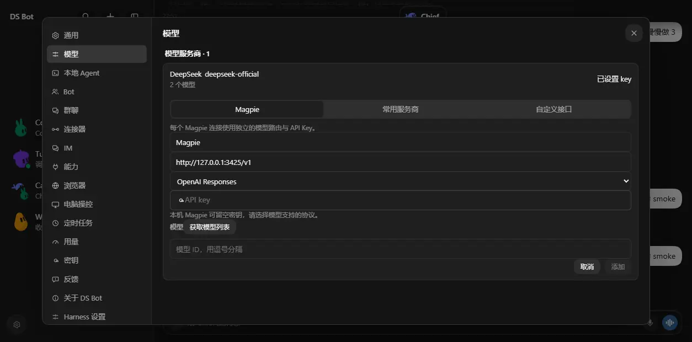

# Turbo source-preview UI evidence

This branch contains reviewed screenshots only. It is separate from the implementation branch.

The Magpie settings form was captured from a real isolated DSH 0.2.2-rc.1 host using synthetic test data. It shows the default local endpoint, Responses protocol and an empty key field before model discovery. It does not demonstrate live Magpie inference.

The implementation was committed at `63e703aa283d17dd1caba67e478e8e8d3e8b12b1`; no UI code changed after capture. The original screenshot was converted to WebP without resizing or cropping.

WebP SHA-256: `53d4caa39825a55f50e98e127edcbd253e7ec6efd457351f8bcb4595b349238e`.

